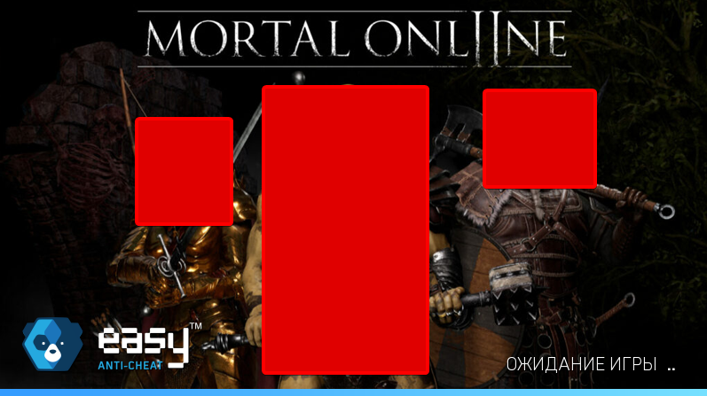
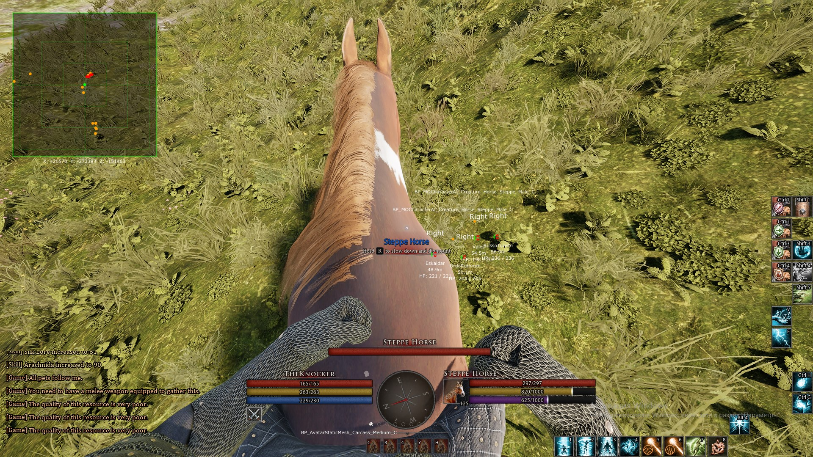
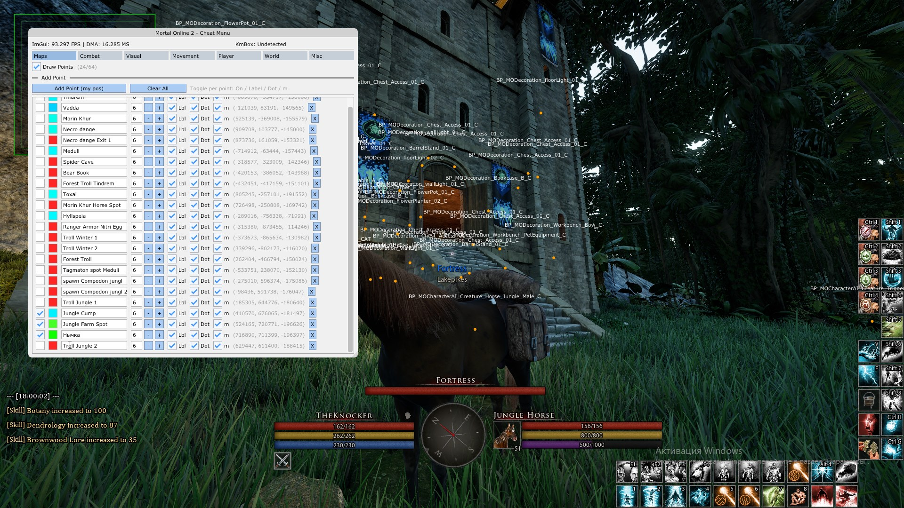
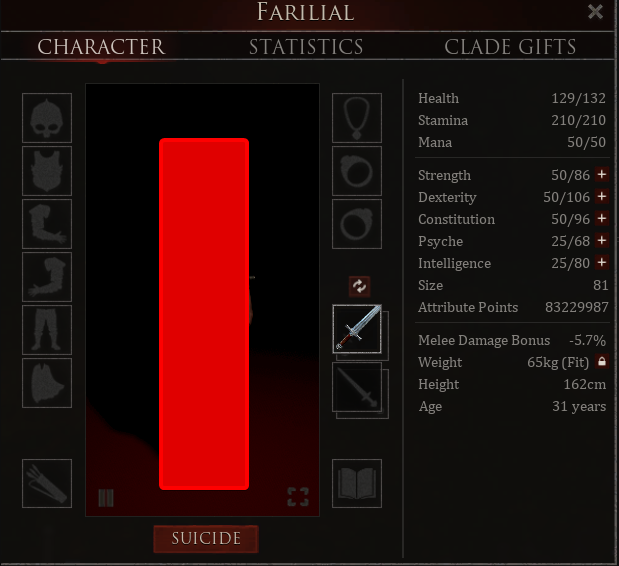

# mo2-dma

**Educational project** — a study of DMA-based memory access, process inspection and
overlay rendering, using *Mortal Online 2* as the target process.

**▶ [Video overview](https://youtu.be/CPIvLlt7CnI?si=YhVxGbHrHT8f261T)**

> ⚠️ This repository exists for **educational purposes only**: to understand how DMA
> devices, physical-to-virtual memory translation and external overlays work at a low
> level. Run it only on hardware you own. Using cheats or bypassing anti-cheat systems
> in online games violates the game's Terms of Service — don't use it on live services.

## The game runs under Easy Anti-Cheat

The first thing to know about this project is that the target process is protected by
**Easy Anti-Cheat**, which is the environment the research was carried out in:

*Easy Anti-Cheat loading screen — the protection the target process runs with.*

## What it does

**Entity overlay** — draws an overlay with information about nearby entities:

**Control menu** — an in-game menu for toggling options and adjusting parameters:

**Characteristics** — the in-game character window showing the parameters of an
already created character (health, stamina, mana, attributes):

## Project structure

| Path | Description |
| --- | --- |
| `DMALibrary/` | Core library — DMA device I/O (LeechCore / VMM), physical & virtual memory read/write, process & module enumeration |
| `Example/` | Sample application — overlay window, entity scanning, settings menu, KMBox input handling |
| `lib/` | Prebuilt `DMALibrary` binaries used by the sample |
| `Screen/` | Screenshots |
| `DMALibrary.sln` | Visual Studio 2022 solution (both projects) |

## Building

1. Open `DMALibrary.sln` in Visual Studio 2022.
2. Select the **Release | x64** configuration.
3. Build the solution — `DMALibrary` and `Example` build together.
